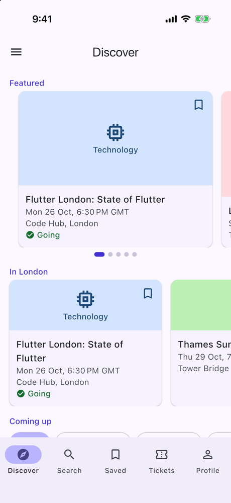
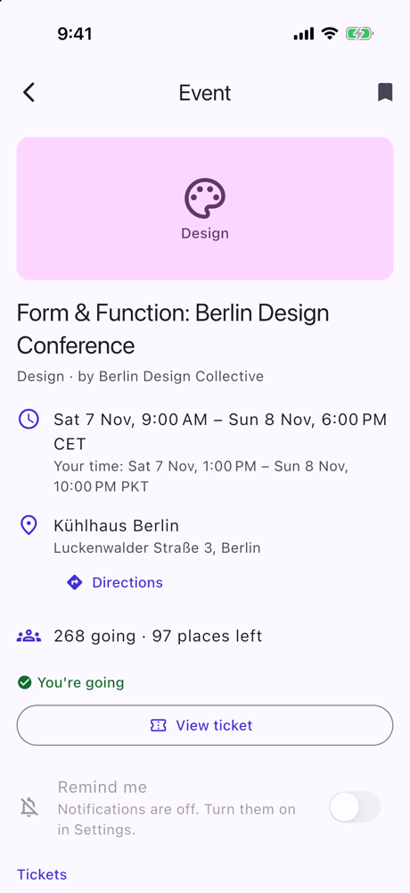
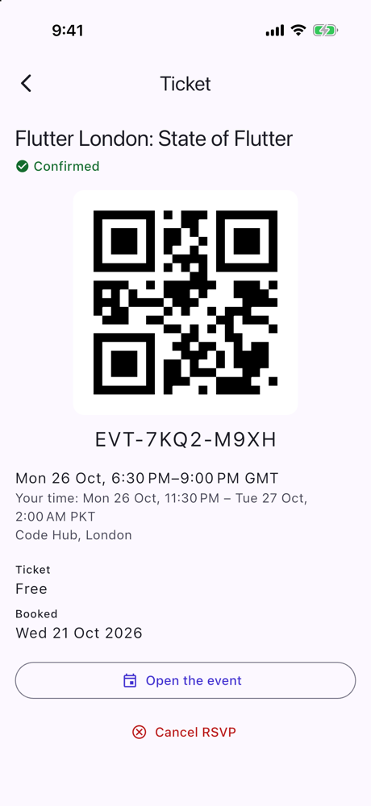
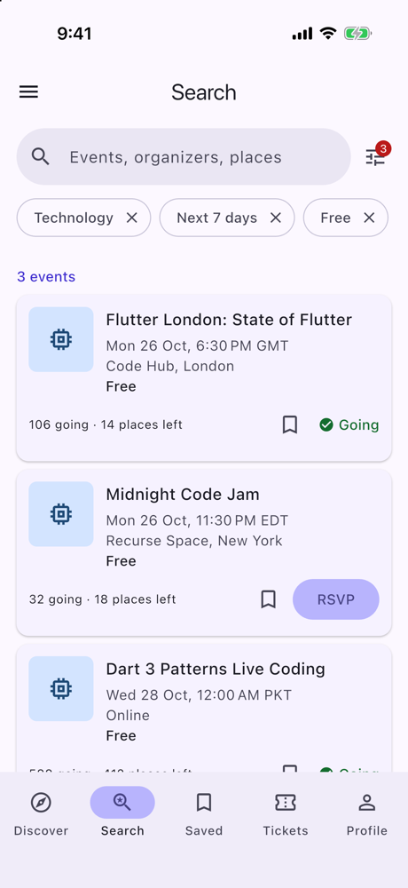
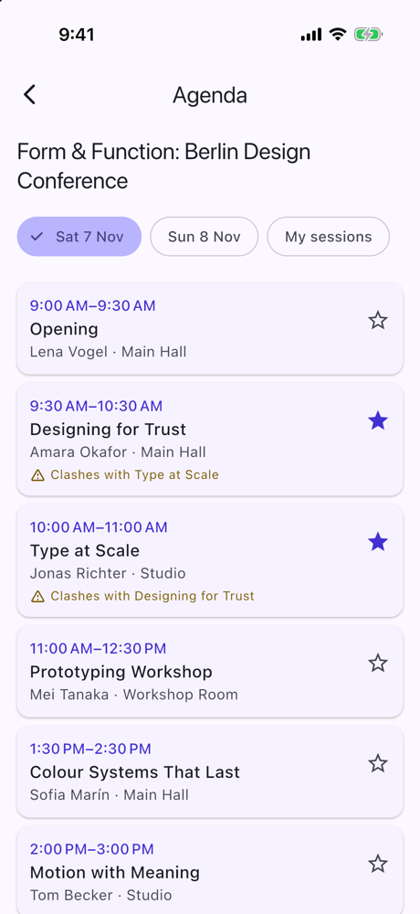
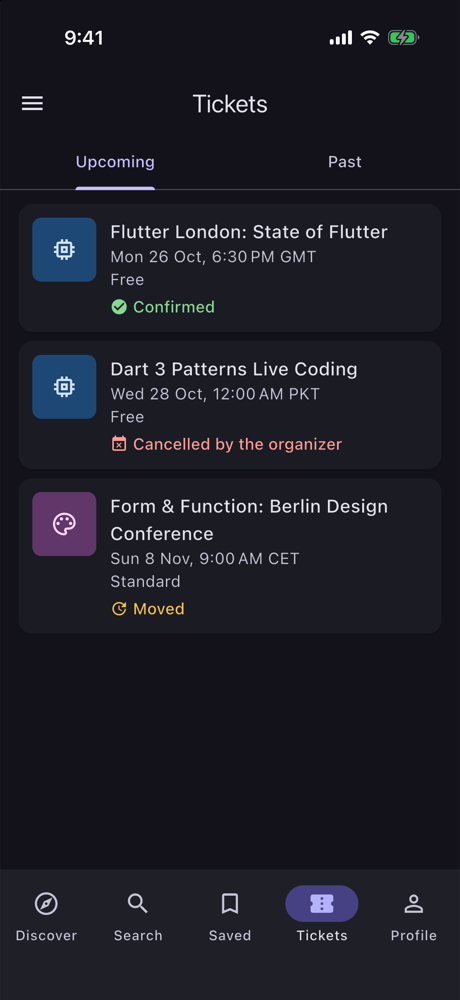
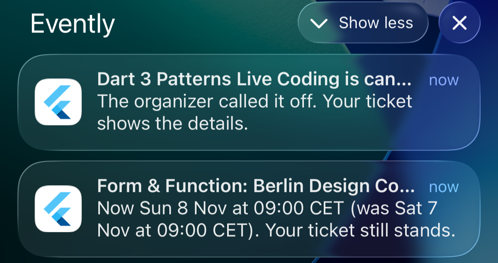
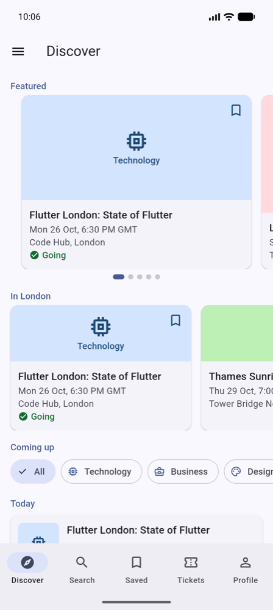

# 🎟️ Evently (Flutter)

[](https://github.com/MuhammadFaheemAkram/Evently-Flutter/actions/workflows/flutter-ci.yml)


A learning-focused, production-inspired **Flutter** event app:
- **discover** events: featured, in your city, coming up, by category;
- **search** them, with filters (category, dates, free or paid, online or in person);
- **save** favourites, **RSVP** with a ticket type, and keep your **tickets** with a QR code;
- follow an event's **agenda** and bookmark sessions;
- follow **organizers**, manage your **profile** and **settings**;
- get **reminders** before the events you're going to.

It is built with **Flutter 3.47**, **Dart 3.13** and a clean, layered architecture, and runs on **Android and iOS**.

Evently is **offline-first**: an in-memory fake API serves the events, the app caches them in a database on the device, and every screen reads that cache. There is **no API key and no server**.

> **Why this repo exists**
>
> It is the Flutter edition of an app that also exists natively for [Android](https://github.com/MuhammadFaheemAkram/Evently) and [iOS](https://github.com/MuhammadFaheemAkram/iEvently). This edition follows the **Android** one closely (its Jetpack Compose UI is already Material 3) and adapts to iOS where the platform has its own conventions. It focuses on:
> - **offline-first over server data:** the event catalog is fetched, cached in drift and refreshed; Discover, Saved, Tickets and an event's page work with no network;
> - **the server's data and the user's, kept apart:** "saved" and "going" are joins, never flags on an event, so a sync can't lose them;
> - **writes the server must confirm:** no ticket exists until the (fake) server books it; a failure writes nothing;
> - **time done properly:** events are instants with their own time zone, shown in the venue's local time;
> - **search with a typed filter**, debounced, over the cache;
> - **notifications planned from your tickets**, and a background sync that notices when an event you're going to moves or is cancelled;
> - typed `go_router` navigation with a tab bar *and* a navigation drawer, code-generated DI, and a test suite that includes an accessibility tour.
>
> Each phase ships with a beginner-to-intermediate friendly write-up in [`docs/`](docs/) that also shows how the Android and iOS editions approached the same feature.

---

## 📋 Project Status

Evently is built in **strict, reviewable phases**. Each phase ends with:
- a building app (Android + iOS);
- a clean analyzer and passing tests;
- a summary doc;
- exactly one commit.

| Phase | Scope | Status |
|------:|-------|:------:|
| 1 | Foundation: FVM project, design system base with the category palette, typed routes with a first-launch gate, 5-tab shell with a navigation drawer, CI | ✅ Done |
| 2 | Data models with time zones, the drift cache (catalog and user tables), the fake API, Welcome | ✅ Done |
| 3 | Discover and Event detail | ✅ Done |
| 4 | Search and Saved | ✅ Done |
| 5 | RSVP, tickets and the agenda | ✅ Done |
| 6 | Organizers, profile and settings | ✅ Done |
| 7 | Notifications and background sync | ✅ Done |
| 8 | Documentation, CI, a final mutation pass | ✅ Done |

---

## ✨ Features

- 🚀 **First launch:** pick your city, then explore with demo data or start fresh
- 🧭 **Discover:** featured events, events in your city, what's coming up by day, categories, pull to refresh, save and RSVP from a card
- 🔎 **Search:** title, organizer, venue or city; filters for category, dates, price, format and RSVP status; recent searches
- 📅 **Event detail:** the venue's local time, location with directions or the join link, places left, ticket prices, the agenda and the organizer, a reminder toggle
- 🎫 **RSVP and tickets:** choose a ticket type, confirmed by the server; tickets with a QR code, upcoming and past, cancel before the start
- 🗓️ **Agenda:** sessions by day, bookmarks, and clashes between them
- 🔖 **Saved:** your saved events, offline
- 👥 **Organizers:** profiles, their events, follow
- 👤 **Profile and settings:** edit your profile; appearance, dynamic color (Android 12+), notifications, your city, clear cache, reset demo data, developer tools
- 🔔 **Reminders:** before events you're going to, a confirmation when you book, a daily summary, and an alert when an event moves or is cancelled
- ♿ **Accessible:** dark mode and large text on every screen, labelled controls, never color alone, checked by a test tour that grows with the app

---

## 📸 Screenshots

| Discover | An event, in another zone | A ticket | Search with filters |
|:---:|:---:|:---:|:---:|
|  |  |  |  |

| The agenda's clashes | Tickets after an update (dark) | Change alerts | Android, dynamic color |
|:---:|:---:|:---:|:---:|
|  |  |  |  |

All 24 (light, dark, large text and Android), with what to look for and how to retake them: [docs/SCREENSHOTS.md](docs/SCREENSHOTS.md).

---

## 🧰 Tech Stack

Packages arrive in the phase that first needs them.

| Area | Choice | Since |
|------|--------|:-----:|
| Toolchain | Flutter 3.47.6 · Dart 3.13, pinned per project with [FVM](https://fvm.app) (`.fvmrc`) | 1 |
| Platforms | Android · iOS 15+ | 1 |
| UI | [`material_ui`](https://pub.dev/packages/material_ui): Material 3 as a standalone package; adaptive widgets on iOS where it matters | 1 |
| Navigation | `go_router` + `go_router_builder` (typed routes, `StatefulShellRoute`, a first-launch `redirect`) | 1 |
| Dependency injection | `get_it` + `injectable` (a code-generated composition root) | 1 |
| Lints / CI | `flutter_lints` + strict analyzer modes; GitHub Actions | 1 |
| State | `flutter_bloc`: Cubits, and one Bloc (`SearchBloc`) with `bloc_concurrency` + `stream_transform` (debounce, restartable) | 2, 4 |
| Models | `freezed` + `json_serializable` (checked DTOs) | 2 |
| Database | `drift` + `drift_flutter` (catalog and user tables, `CHECK`s, a partial unique index, `shareAcrossIsolates`; schema exported to `drift_schemas/`) | 2 |
| Preferences | `shared_preferences` (`SharedPreferencesWithCache`, resolved before `runApp`) | 2 |
| Time | `timezone` (each event's IANA zone), `clock`, `intl`; `flutter_timezone` (the device's zone) | 2, 3 |
| Links | `url_launcher` (directions and join links, `https` only) | 3 |
| QR codes | `qr_flutter` (black on white in both themes) | 5 |
| iOS touches | `cupertino_ui` (adaptive dialogs) | 5 |
| Dynamic color | `dynamic_color` (the wallpaper's palette, Android 12+) | 6 |
| App info | `package_info_plus` | 6 |
| Notifications | `flutter_local_notifications` (planned and diffed, three Android channels, taps on a cold and a warm start) | 7 |
| Background work | `workmanager` (WorkManager on Android, BGTaskScheduler on iOS; a background isolate with its own graph) | 7 |
| Testing | `flutter_test`, `bloc_test`, `mocktail`, `fake_async` | 1, 2 |

---

## 🏛️ Architecture

A clean, layered architecture with a one-directional data flow:

```
lib/
├── app/        → root widget (MaterialApp.router, themes)
├── background/ → the OS's entry point for the background sync, and its hand-built graph
├── core/       → design system, navigation, the database, the fake API, preferences, notifications, background work
├── data/       → repository implementations, mappers, the API guard
├── domain/     → models, contracts, use cases (pure Dart)
├── features/   → one folder per screen (Page + View + Cubit/Bloc)
└── di/         → composition root (get_it + injectable)
```

**Navigation:**

```
GoRouter ── redirect: firstLaunchRedirect(onboarded, location)   ◀── refreshListenable (the saved settings)
  │
  ├─ /welcome          (until the user has started)
  │
  ├─ tab shell         StatefulShellRoute ── MainShell (NavigationBar + navigation drawer)
  │                      /discover · /search · /saved · /tickets · /profile
  │
  └─ root-level        /events/:eventId (+ /rsvp, /agenda), /tickets/:ticketId, /organizers/:organizerId,
     screens           /following, /profile/edit, /settings, /about
                       → pushed above the tab bar; RSVP and Edit profile open as full-screen dialogs
```

Key rules:
- **The router owns the gate.** No screen navigates after Welcome's choice: it saves the choice, and `refreshListenable` (a `StreamListenable` over the settings) re-runs the pure `firstLaunchRedirect`.
- **Typed routes only:** no string paths in widgets.
- **Tabs and a drawer, as in the Android edition.** The five tabs are a `NavigationBar`; Following, Settings and About live in a drawer that slides over the whole screen. Every tab's app bar opens it, and Profile also opens Settings.
- **Screens above the tabs** are pushed on the root navigator, so Back, and the iOS edge swipe, return to the tab with its state intact. Links work: `/events/e1/rsvp` opens the booking dialog over its event, and a link opened cold gets a Close button.
- **Widgets render state; logic lives elsewhere.** Each screen is a Page plus a View.
- **Layer boundaries:** `domain/` is pure Dart, Views never import `data/`, and only `data/` touches the database and the API.

**Data:**

```
FakeEventlyApi (seed rendered from its calendar's anchor, 700 ms) ─▶ checked DTOs ─▶ mappers (rules) ─▶ drift
                                                                                       │
   catalog: organizers, events (+ offers, sessions)   ◀── user rows point here, never CASCADE
   user:    saved, tickets (one active per event), bookmarks, follows, reminders, changes, searches, profile
                                                                                       │
                                      every screen reads the database, never the API ◀─┘
```

- **Time:** an event is two UTC instants plus its venue's IANA zone (`EventTime`). An in-person event is told on its venue's clock (with "Your time" below when it differs), an online one on the user's; "Today" and "Tomorrow" are the user's days (`EventClock`, `UserTimeZone`).
- **Bookings confirmed by the server:** no ticket until the (fake) server answers; the ticket and the event's new place counts are written in one transaction; a failure writes nothing. Codes carry a Luhn check character.
- **Search over the cache:** text plus a typed `EventFilter` (categories, dates, price, format, RSVP), compiled to one drift query; debounced and restartable in `SearchBloc`; works offline.
- **Joins, not flags:** "saved" and "going" are LEFT JOINs over the user's rows, re-read by drift on every save or booking, so every screen follows at once.
- **The server's data and the user's, apart:** a refresh upserts the catalog in one transaction (`ON CONFLICT DO UPDATE`, never `REPLACE`, never deleting); "saved" and "going" are the user's own rows.
- **Failures are values:** repositories return a `Result` with an `AppException` (offline, damaged data, unknown); on any failure nothing is written.

**Notifications and background work:**

```
tickets, saves, reminder toggles, the catalog, settings ──settled──▶ planNotifications (pure) ──▶ diff ──▶ the device
a refresh ── one transaction: upsert, mark the gone cancelled, diffCatalog, record changes ──▶ alerts, claimed once
workmanager (≈6 h) ──▶ callbackDispatcher ──▶ BackgroundGraph (its own small graph, the same database) ──▶ refresh → alert → re-plan
```

- **Planned as data, applied as a diff:** reminders a lead time before events you're going to, a daily summary; stable ids; at most 60; the switch reads "on" only while the system allows notifications. See [NOTIFICATIONS.md](docs/NOTIFICATIONS.md).
- **A sync that notices changes:** a moved or cancelled event you hold a ticket for is recorded once (inside the refresh's transaction), shows on the ticket, and is alerted once across both isolates. See [BACKGROUND_WORK.md](docs/BACKGROUND_WORK.md).

---

## 🗂️ Folder Structure

```
Evently/
├── .fvmrc                          # pinned Flutter version (3.47.6)
├── .github/                        # workflows/flutter-ci.yml, issue and PR templates
├── analysis_options.yaml           # lints + strict analyzer modes
├── build.yaml                      # drift options, lint-free generated files
├── assets/json/                    # catalog_seed.json, demo_user.json, catalog_update.json (the fake API's seed)
├── drift_schemas/                  # each exported schema version
├── docs/                           # the guides below, the phase write-ups, screenshots/
├── lib/
│   ├── main.dart                   # binding → time zones → configureDependencies() → background work
│   │                               # → the launch notification's screen → runApp
│   ├── app/                        # EventlyApp: themes, the router, the notification sync, resume, taps
│   ├── background/                 # the OS's entry point (workmanager) and its hand-built BackgroundGraph
│   ├── core/
│   │   ├── common/                 # Result, AppException, guardWrite, EventClock, Stream.settled
│   │   ├── database/               # tables/, app_database (shared across isolates), daos/, converters
│   │   ├── design_system/          # theme/, formatting/ (EventFormats), widgets/ (event cards, ZonedTimeText,
│   │   │                           # ReminderToggle, the time picker, …), UserTimeZone, large_text
│   │   ├── navigation/             # app_routes (+ .g.dart), app_router, first_launch_redirect, stream_listenable, Close fallback
│   │   ├── network/                # EventlyApi, FakeEventlyApi, SeedRenderer, DemoCalendar, NetworkSimulator, dto/
│   │   ├── platform/               # LocalNotifications, WorkmanagerBackgroundWork, UrlLauncherLinkOpener,
│   │   │                           # MaterialYouColorSource, the device's time zone
│   │   └── storage/                # SettingsLocalDataSource (the preference keys)
│   ├── data/                       # mapper/, repository/ (+ the API guard)
│   ├── domain/                     # model/, calculation/ (pure rules, diffCatalog, planNotifications),
│   │                               # repository/ (contracts), service/, usecase/
│   ├── features/                   # welcome, shell (tabs + drawer), discover, search, saved, tickets, profile,
│   │                               # event_detail, rsvp, agenda, ticket_detail, organizer, following, profile_edit, settings, about
│   └── di/                         # injection.dart (+ .config.dart), app_module.dart
└── test/                           # mirrors lib/, plus app/ (flows, the accessibility tour), background/,
                                    # and helpers/ (the data stack, fixtures, fakes)
```

---

## 🎭 The Demo and the Fake API

There is **no backend, no account and no API key**. `FakeEventlyApi` plays the server behind the same interface a real client would use (fetch the catalog, fetch the demo user, RSVP, cancel), after a 700 ms simulated delay:

- **The seed** (`assets/json/`): 6 organizers and 25 events in London, Berlin, New York and Lahore (4 online), with ticket offers and agendas; a demo user (Sara Ahmed) with 4 saved events, 4 tickets, 3 bookmarked sessions and 2 follows.
- **Written the way people plan:** "in 3 days at 18:30, in London", rendered to instants with the venue's offset, counting from a **calendar anchor** set at the first fetch, so the demo ages like real data. Reset demo data starts it again from today.
- **Server state in memory:** places taken, the tickets it issued (one active per event). It checks every booking again: cancelled, started, sold out, already going.
- **Developer switches** (Settings → Developer): **Simulate network failure**, **Publish a catalog update** (an event you're going to moves, another is cancelled, one is edited, two appear), **Run background sync now**, **Show planned notifications**.

See [API_SIMULATION.md](docs/API_SIMULATION.md).

---

## 💾 Local Persistence

- **drift (SQLite)** holds the cached catalog and the user's data, in separate tables: `CHECK`s for every rule a row must keep, a partial unique index for one active ticket per event, foreign keys on, and no cascade from the user's rows (a saved or booked event can't be deleted). Shared across isolates with the background sync. See [DATA_MODEL.md](docs/DATA_MODEL.md).
- **`SharedPreferencesWithCache`** holds the settings, read before the first frame, written key by key, reloaded on resume after the app's own writes.
- **Offline:** every screen reads the cache; saves, bookmarks, follows and reminders work without a network; bookings wait for the server. See [OFFLINE_FIRST.md](docs/OFFLINE_FIRST.md).

---

## ▶️ How to Run

Prerequisites:
- [FVM](https://fvm.app);
- Xcode, for iOS;
- the Android SDK, with Java 17+ (Android Studio's bundled JDK works).

```bash
fvm install            # installs the version pinned in .fvmrc (3.47.6)
fvm flutter pub get
fvm flutter run        # pick an Android emulator or an iOS simulator
```

Generated code (`*.g.dart`, `*.config.dart`) is committed, so the app runs straight after cloning. After changing annotated code, regenerate it:

```bash
fvm dart run build_runner build
```

---

## ✅ Testing

```bash
fvm flutter analyze
fvm dart format --output=none --set-exit-if-changed .
fvm flutter test
```

**900 tests**, counted by area in [TESTING.md](docs/TESTING.md):

| Area | Tests |
|---|---:|
| Screens: Cubits, the Bloc and views | 231 |
| Mappers and repositories (the cache, bookings, change detection, settings) | 117 |
| Domain rules and the notification planner | 103 |
| Design system (themes, WCAG contrast, formatting in four zones, widgets) | 91 |
| Database (constraints, foreign keys, the upsert, the search query, Clear cache) | 78 |
| Accessibility tour (every screen and state, light and dark, 200 % text) | 71 |
| The fake server and the seed | 51 |
| Domain models (time across zones and clock changes) | 41 |
| App-level flows on the real DI graph | 35 |
| Use cases (booking, plan → diff → apply, alerts, the background sync) | 34 |
| Navigation | 31 |
| Common, DI, the background dispatch | 13 |

- **Mutation checks:** 175 behaviours were broken on purpose, from "a sync never deletes" to "one active ticket per event" to "a change is alerted once", and each made a test fail.
- **On devices:** every phase was checked on an iPhone simulator (light, dark, large text); dynamic color, notifications, the background worker and a release build also on an Android 16 emulator.

CI (`.github/workflows/flutter-ci.yml`) runs on every push to `main` and every pull request. It installs the FVM-pinned Flutter, checks that the committed generated code is up to date and complete, then runs format, analyze and test.

---

## 📱 Same App on Other Platforms

| Edition | Stack | Repo |
|---------|-------|------|
| Android | Kotlin · Jetpack Compose · Hilt · Room · DataStore · WorkManager | [MuhammadFaheemAkram/Evently](https://github.com/MuhammadFaheemAkram/Evently) |
| iOS | Swift 6 · SwiftUI · SwiftData · UserNotifications · BGTaskScheduler | [MuhammadFaheemAkram/iEvently](https://github.com/MuhammadFaheemAkram/iEvently) |
| **Flutter** | Dart · Flutter · Bloc · drift · workmanager | this repo |

| Concept | Android | iOS | Flutter |
|---|---|---|---|
| UI | Jetpack Compose | SwiftUI | widgets + `material_ui` (adaptive where it matters) |
| Navigation | bottom bar + drawer | `TabView` | `StatefulShellRoute` + `NavigationBar` + a `Drawer` |
| Screen state | ViewModel + StateFlow | `@Observable` | Cubit / Bloc |
| Cache | Room + DataStore | SwiftData + `@AppStorage` | drift + `SharedPreferencesWithCache` |
| Fake API | Retrofit-style services | protocols + fakes | `EventlyApi`, in memory, seeded from JSON |
| Saved / RSVP state | `isSaved`, `isRsvped` on `Event` | the same | joins over the user's tables, so a sync can't lose them |
| Reminders | WorkManager + NotificationManager | UserNotifications | `flutter_local_notifications`, planned and diffed, plus change alerts |
| Background | WorkManager | BGTaskScheduler | `workmanager` (both), a background isolate with its own graph |
| DI | Hilt | `AppEnvironment` | `get_it` + `injectable` (+ the background graph) |

---

## 📚 Documentation

**Guides**
- [Architecture](docs/ARCHITECTURE.md): layers, ownership, state, errors, navigation, DI, key decisions
- [Data model](docs/DATA_MODEL.md): tables, constraints, joins, transactions, preferences
- [Offline-first](docs/OFFLINE_FIRST.md): the cache, refresh and sync, server-confirmed writes, what works offline
- [Time zones](docs/TIME_ZONES.md): instants and zones, which clock each screen shows, worked examples
- [Notifications](docs/NOTIFICATIONS.md): the planner, the diff, change alerts, permission, taps
- [Background work](docs/BACKGROUND_WORK.md): workmanager on both platforms, the background graph, the shared database
- [API simulation](docs/API_SIMULATION.md): the fake server, its seed and calendar, bookings, the catalog update
- [Testing](docs/TESTING.md): what's covered, how the tests are built, every mutation check
- [Learning notes](docs/LEARNING_NOTES.md) and [interview notes](docs/INTERVIEW_NOTES.md)
- [Screenshots](docs/SCREENSHOTS.md) and the [roadmap](docs/ROADMAP.md)

**Phase write-ups** (each with an Android / iOS comparison)
- [Phase 1 — Foundation](docs/PHASE_1_SUMMARY.md)
- [Phase 2 — Data layer](docs/PHASE_2_SUMMARY.md)
- [Phase 3 — Discover and Event detail](docs/PHASE_3_SUMMARY.md)
- [Phase 4 — Search and Saved](docs/PHASE_4_SUMMARY.md)
- [Phase 5 — RSVP, tickets and the agenda](docs/PHASE_5_SUMMARY.md)
- [Phase 6 — Organizers, profile and settings](docs/PHASE_6_SUMMARY.md)
- [Phase 7 — Notifications and background sync](docs/PHASE_7_SUMMARY.md)
- [Phase 8 — Documentation and CI](docs/PHASE_8_SUMMARY.md)

**Contributing:** [CONTRIBUTING](CONTRIBUTING.md) · [Code of Conduct](CODE_OF_CONDUCT.md) · [Security](SECURITY.md) · [Changelog](CHANGELOG.md)

---

## 🗺️ Roadmap

All eight phases are done. Next ideas (exact alarms on Android, a real backend with push, add to calendar, an app icon, …) are in [docs/ROADMAP.md](docs/ROADMAP.md).

---

## 📄 License

[MIT](LICENSE) © 2026 BitFuse
